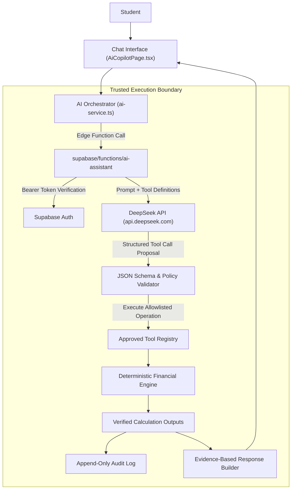

# TuitionShield AI — AI Agent & Controlled Tool-Calling Design

**Integration:** DeepSeek API (`deepseek-chat`) via Trusted Supabase Edge Function  
**Edge Function Path:** `supabase/functions/ai-assistant/index.ts`  
**Client Orchestrator:** `src/features/ai-assistant/ai-service.ts`  
**Test Suite:** `src/test/ai-agent.test.ts` (6/6 Tests Passing)  
**Status:** Implemented, Fully Tested, and Verified  

---

## 1. Agent Architecture & Role

TuitionShield AI uses an agentic architecture where DeepSeek acts as an **intelligent financial participant**, rather than a generic text generator.

---

## 2. Security Boundaries & Inviolable Guardrails

1. **No Autonomous Money Movement:** The AI agent possesses **zero capability to execute financial payments**. Calling `create_payment_proposal` creates a record in `awaiting_approval` status. It cannot approve or execute payments.
2. **Deterministic Arithmetic Grounding:** The language model is forbidden from performing authoritative mental math. All figures presented to the student originate from verified tool outputs.
3. **Strict Tool Allowlist:** Any tool proposal not present in the allowlist is rejected immediately with an authorization error.
4. **Input Schema Validation:** Every tool argument is validated against JSON schemas with `additionalProperties: false`.
5. **Session Identity Binding:** The user ID is extracted from the verified Supabase Auth JWT, never accepted from an LLM argument.
6. **Auditability:** Every tool invocation records an audit event (`ai_tool_invoked`) capturing actor type, tool name, arguments, and timestamp.

---

## 3. Approved Tool Registry

| Tool Name | Parameters | Allowed Output | Security Controls |
|---|---|---|---|
| `get_financial_summary` | None | Starting balance, confirmed funding, pending funding, costs, gap | Read-only. Fetches authorized plan records. |
| `calculate_funding_gap` | `currency?: string` | Numerical breakdown of funding gap and surplus | Calls pure deterministic calculation function. |
| `forecast_cash_flow` | None | Monthly balance progression, deficit dates, lowest balance | Dated chronological projection. |
| `detect_financial_risks` | None | Array of factual risks with evidence and recommendations | Grounded in deterministic risk rules. |
| `simulate_financial_scenario` | `rent_increase_percent`, `living_cost_increase_percent`, `tuition_adjustment_minor`, `scholarship_delay_months`, `scholarship_cancelled`, `part_time_monthly_income_minor` | Baseline vs. scenario gap, variance, key drivers | Clones baseline; baseline records are untouched. |
| `list_upcoming_obligations` | `category?: string` | Sorted list of upcoming unpaid obligations | Read-only. Filtered by category. |
| `create_payment_proposal` | `amount_minor`, `currency`, `recipient_label`, `purpose`, `obligation_id?` | Generated proposal object with status `awaiting_approval` | **Creates proposal only.** Does NOT execute payment. Requires student physical approval. |
| `get_payment_status` | `proposal_id: string` | Current status, approval hash, execution record | Verified against proposal records. |

---

## 4. DeepSeek API Server Configuration

- **Secret Variable:** `DEEPSEEK_API_KEY` (Stored securely in Supabase Secrets or server environment; **never exposed to client**).
- **Model Configuration:** Configurable via `DEEPSEEK_MODEL` (Defaults to `deepseek-chat`).
- **Endpoint:** `https://api.deepseek.com/chat/completions`.
- **Calling Strategy:** Function calling with `tools: APPROVED_TOOLS`, `tool_choice: "auto"`, `temperature: 0.2`.

---

## 5. Verification & Test Evidence

All 6 test cases in `src/test/ai-agent.test.ts` pass:
- **A-01 `get_financial_summary`:** Returns verified calculations (€8,000 available, €10,500 costs, €2,500 gap).
- **A-02 `calculate_funding_gap`:** Provides deterministic outputs without LLM arithmetic.
- **A-03 `simulate_financial_scenario`:** Simulates rent increase (+€630 gap) with baseline untouched.
- **A-04 Rejects Unauthorized Tool:** Attempting `execute_arbitrary_sql_query` fails safely.
- **A-05 Payment Safety:** `create_payment_proposal` sets status `awaiting_approval` and does not create transactions.
- **A-06 Full Orchestration & Audit:** `sendChatMessage` invokes tools and appends an `ai_tool_invoked` audit record.
