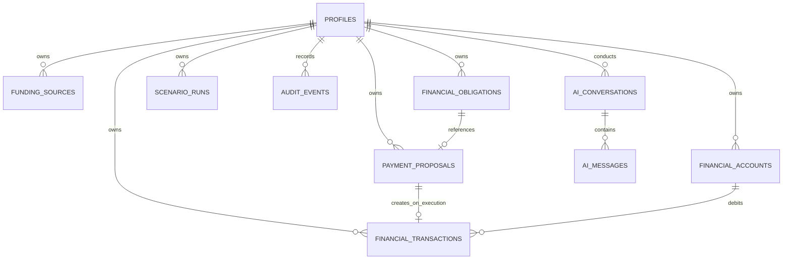

# TuitionShield AI — Database Design & Data Dictionary

**Database:** Supabase PostgreSQL  
**Migrations Committed:**  
- `supabase/migrations/20261012000001_initial_schema.sql` (Tables & Indexes)  
- `supabase/migrations/20261012000002_rls_and_functions.sql` (RLS & Secure RPCs)  
- `supabase/seed.sql` (Competition Demonstration Dataset)  
**Status:** Implemented, Fully Specified, and Tested  

---

## 1. Relational Entity Diagram

---

## 2. Table Specifications & Data Dictionary

### 2.1 `profiles`
Stores student profile metadata linked to Supabase Auth (`auth.users.id`).
- `id` (UUID, PK, References `auth.users(id)` ON DELETE CASCADE)
- `display_name` (TEXT)
- `destination_country` (TEXT) — e.g. "Germany"
- `university` (TEXT) — e.g. "Technical University of Munich"
- `study_program` (TEXT) — e.g. "M.Sc. Sustainable FinTech"
- `study_start_date` (DATE)
- `study_duration_months` (INTEGER)
- `home_currency` (VARCHAR(3), NOT NULL, DEFAULT 'EUR')
- `reserve_threshold_minor` (BIGINT, NOT NULL, DEFAULT 100000) — €1,000 buffer
- `onboarding_completed` (BOOLEAN, NOT NULL, DEFAULT false)
- `created_at`, `updated_at` (TIMESTAMPTZ)

### 2.2 `financial_accounts`
Represents declared financial accounts (savings, blocked accounts, cash reserves).
- `id` (UUID, PK, DEFAULT `uuid_generate_v4()`)
- `user_id` (UUID, FK `profiles.id`)
- `name` (TEXT, NOT NULL)
- `currency` (VARCHAR(3), NOT NULL)
- `balance_minor` (BIGINT, NOT NULL) — Stored in integer cents
- `account_type` (TEXT, CHECK: `checking`, `savings`, `cash`, `term_deposit`, `other`)
- `source_type` (TEXT, CHECK: `manual_declaration`, `document_import`, `sandbox_seed`)
- `verified_status` (TEXT, CHECK: `declared`, `reviewed`, `pending_evidence`)
- `as_of_date` (DATE, NOT NULL)

### 2.3 `funding_sources`
Tracks income, scholarships, family support, and grants.
- `id` (UUID, PK)
- `user_id` (UUID, FK `profiles.id`)
- `name` (TEXT, NOT NULL)
- `amount_minor` (BIGINT, NOT NULL, CHECK >= 0)
- `currency` (VARCHAR(3), NOT NULL)
- `status` (TEXT, CHECK: `pending`, `confirmed`, `received`, `cancelled`)
- `expected_date` (DATE)
- `source_type` (TEXT, CHECK: `scholarship`, `family_support`, `personal_savings`, `part_time_job`, `grant`, `student_loan`, `other`)

### 2.4 `financial_obligations`
Tracks mandatory education and living costs.
- `id` (UUID, PK)
- `user_id` (UUID, FK `profiles.id`)
- `title` (TEXT, NOT NULL)
- `category` (TEXT, CHECK: `tuition`, `housing`, `food`, `transportation`, `insurance`, `visa`, `travel`, `books`, `personal`, `other`)
- `amount_minor` (BIGINT, NOT NULL, CHECK >= 0)
- `currency` (VARCHAR(3), NOT NULL)
- `due_date` (DATE, NOT NULL)
- `status` (TEXT, CHECK: `planned`, `due`, `paid`, `cancelled`, `overdue`)
- `is_essential` (BOOLEAN, DEFAULT true)

### 2.5 `payment_proposals`
Represents the state machine for controlled simulated payments.
- `id` (UUID, PK)
- `user_id` (UUID, FK `profiles.id`)
- `obligation_id` (UUID, FK `financial_obligations.id`)
- `amount_minor` (BIGINT, NOT NULL, CHECK > 0)
- `currency` (VARCHAR(3), NOT NULL)
- `recipient_label` (TEXT, NOT NULL)
- `purpose` (TEXT, NOT NULL)
- `status` (TEXT, CHECK: `draft`, `validated`, `awaiting_approval`, `approved`, `executing`, `executed`, `rejected`, `failed`, `expired`)
- `approval_hash` (TEXT) — SHA signature binding immutable details
- `approved_at`, `executed_at` (TIMESTAMPTZ)
- `expires_at` (TIMESTAMPTZ, NOT NULL)
- `idempotency_key` (TEXT, NOT NULL, UNIQUE)
- `transaction_id` (UUID, FK `financial_transactions.id`)

### 2.6 `financial_transactions`
The sandbox ledger recording executed simulated transfers.
- `id` (UUID, PK)
- `user_id` (UUID, FK `profiles.id`)
- `account_id` (UUID, FK `financial_accounts.id`)
- `transaction_type` (TEXT, CHECK: `inflow`, `outflow`)
- `amount_minor` (BIGINT, NOT NULL)
- `currency` (VARCHAR(3), NOT NULL)
- `status` (TEXT, CHECK: `completed`, `pending`, `failed`, `reversed`)
- `category` (TEXT)
- `description` (TEXT)
- `source_type` (TEXT, CHECK: `sandbox_ledger`, `manual`, `imported`)
- `source_reference` (TEXT)
- `idempotency_key` (TEXT, UNIQUE)

### 2.7 `audit_events`
Append-only log for compliance and competition evidence.
- `id` (UUID, PK)
- `user_id` (UUID, FK `profiles.id`)
- `actor_type` (TEXT, CHECK: `user`, `system`, `ai_agent`)
- `event_type` (TEXT, NOT NULL)
- `resource_type` (TEXT, NOT NULL)
- `resource_id` (UUID)
- `result` (TEXT, CHECK: `success`, `denied`, `failure`, `warning`)
- `details` (JSONB, NOT NULL, DEFAULT `{}`)

---

## 3. Row Level Security (RLS) Policies

All tables have RLS enabled:
1. `profiles`: `SELECT`, `UPDATE`, `INSERT` restricted to `auth.uid() = id`.
2. `financial_accounts`, `funding_sources`, `financial_obligations`, `scenario_runs`: CRUD restricted to `auth.uid() = user_id`.
3. `financial_transactions`: Read-only for authenticated clients (`auth.uid() = user_id`). Direct client `INSERT`/`UPDATE` is blocked; writes must occur via the trusted RPC.
4. `audit_events`: Read-only for authenticated users. Direct inserts from clients are disallowed (append-only via backend).

---

## 4. Secure Server-Side Stored Procedures

Defined in `supabase/migrations/20261012000002_rls_and_functions.sql`:
1. `approve_payment_proposal(p_proposal_id, p_expected_hash)`:
   - Validates user identity and ownership.
   - Verifies proposal status is `awaiting_approval`.
   - Checks expiration time.
   - Compares immutable details hash against `p_expected_hash`.
   - Updates status to `approved` and logs audit record.
2. `execute_sandbox_payment_transaction(p_proposal_id, p_idempotency_key)`:
   - Locks proposal with `FOR UPDATE`.
   - Idempotently returns existing transaction if already `executed`.
   - Validates that proposal status is `approved`.
   - Verifies sandbox balance sufficiency and deducts funds.
   - Atomically inserts ledger entry into `financial_transactions`.
   - Updates linked obligation to `paid` and proposal to `executed`.
   - Records audit event `sandbox_payment_executed`.
