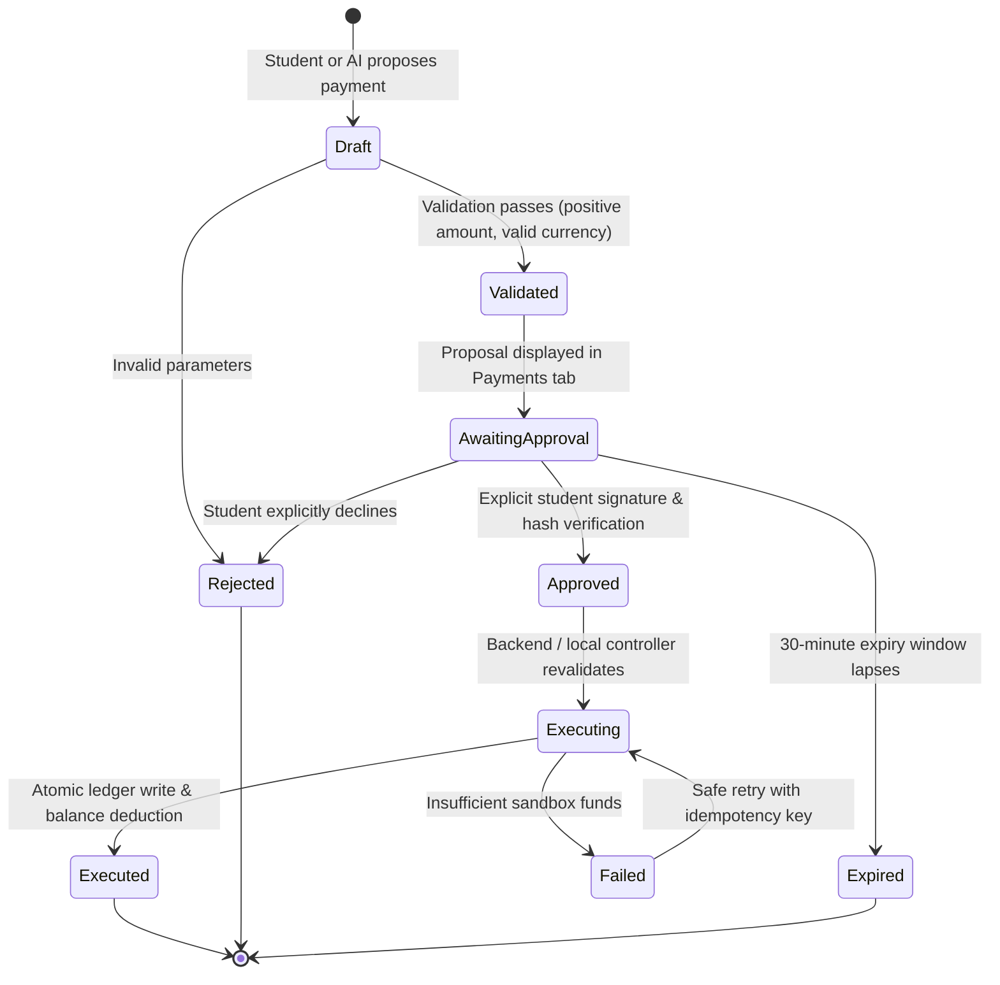

# TuitionShield AI — Sandbox Payment Workflow & State Machine

**Topic:** Topic C — Cross-border & Student Finance Assistant  
**Implementation Modules:**  
- Frontend Controller: `src/features/payments/PaymentsPage.tsx`  
- Local State Machine Engine: `src/lib/storage/mock-db.ts`  
- Backend Migration: `supabase/migrations/20261012000002_rls_and_functions.sql`  
- Test Suite: `src/test/payments.test.ts` (7/7 Tests Passing)  
**Status:** Implemented, Fully Tested, and Verified  

---

## 1. Workflow Architecture & Objectives

The sandbox payment workflow is a central demonstration component of TuitionShield AI for the 2026 Shenzhen International FinTech Competition.

It demonstrates how an AI co-pilot can prepare and facilitate a complex tuition transaction **without possessing autonomous authorization to move money**.

---

## 2. Step-by-Step Transaction Lifecycle

### Step 1 — Proposal Generation
- Can be triggered manually or by asking the AI agent: *"Prepare a sandbox tuition payment for my review."*
- Generates a unique proposal ID (`prop-XXXX`) with status `awaiting_approval`.
- Computes an **immutable approval hash**:
  $$\text{approval\_hash} = \text{SHA256}(\text{user\_id} \parallel \text{amount\_minor} \parallel \text{currency} \parallel \text{recipient} \parallel \text{purpose} \parallel \text{obligation\_id})$$
- Sets expiration time (30 minutes from creation).
- **Security Check:** At this point, no transaction exists in the ledger, and no account balance has changed.

### Step 2 — Explicit Review & Signature
- The student opens the proposal review modal.
- The modal presents:
  - Payee (e.g. Technical University of Munich)
  - Purpose (e.g. Semester 1 Tuition Fee)
  - Amount & Currency (e.g. €2,000.00 EUR)
  - Immutable Details Signature Hash
  - Prominent Sandbox Warning Banner
- The student must check the explicit authorization confirmation box:
  > *"I, as the authenticated student owner, have reviewed the beneficiary and amount details and explicitly authorize this simulated sandbox transfer."*
- Clicking "Confirm & Approve" calls `approvePaymentProposal`. The engine re-computes the hash and verifies that no parameters were tampered with. The proposal moves to status `approved`.

### Step 3 — Atomic Sandbox Execution & Idempotency
- Clicking "Execute Sandbox Payment" sends the proposal ID and a unique `idempotency_key`.
- The controller:
  1. Verifies that the proposal is in status `approved` and has not expired.
  2. Checks for an existing executed transaction matching the proposal ID or idempotency key. If found, it returns the existing transaction immediately without creating a second debit (idempotent replay).
  3. Verifies that the sandbox account has sufficient balance ($B \ge \text{amount}$).
  4. Deducts the amount from the account balance.
  5. Atomically inserts an entry into `financial_transactions` (`source_type: 'sandbox_ledger'`).
  6. Updates the linked tuition obligation to `paid`.
  7. Updates proposal status to `executed`.
  8. Records audit event `sandbox_payment_executed`.

---

## 3. Test Verification Results

All 7 test cases in `src/test/payments.test.ts` pass:
- **P-01 Proposal Creation:** Proposal created in `awaiting_approval` without executing; ledger remains empty.
- **P-02 Execution Blocked Without Approval:** Attempting execution while `awaiting_approval` throws error.
- **P-03 Rejection Prevents Execution:** Declined proposal marked `rejected` and cannot be executed.
- **P-04 & P-05 Cryptographic Hash Verification:** Modifying proposal details invalidates approval signature.
- **P-06 Successful Execution:** Debits €2,000 from €8,000 account ($\rightarrow$ €6,000), marks tuition as paid, creates 1 ledger entry, logs audit record.
- **P-07 Idempotency Protection:** Repeating identical execution request produces exactly **one** ledger entry.
- **P-08 Insufficient Funds Handling:** Proposal fails safely when balance is insufficient, without corrupting ledger.
