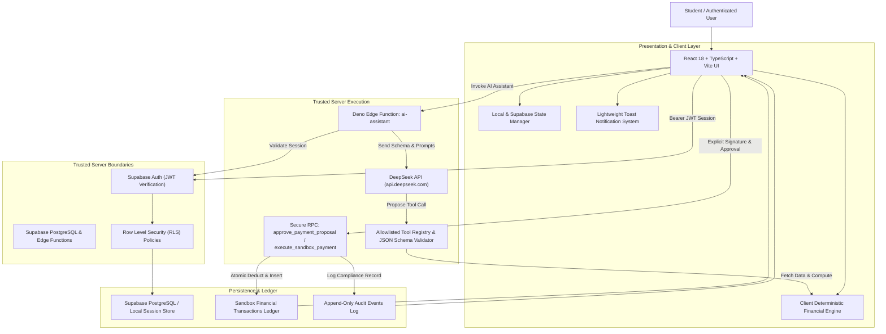

# TuitionShield AI — System Architecture Specification

**Project:** TuitionShield AI  
**Competition:** 2026 Shenzhen International FinTech Competition — International Track  
**Topic:** Topic C — Cross-border & Student Finance Assistant  
**Theme:** AI as a Controlled Financial Participant  
**Document Version:** 2.0 (Verified Implementation Status)  
**Implementation Status:** Implemented & Verified (Frontend, Local Storage DB, Deterministic Financial Engine, DeepSeek AI Assistant Server Function, Sandbox Payment Workflow, Automated Vitest Suite).

---

## 1. System Overview

TuitionShield AI is an AI-powered financial co-pilot built specifically for international students preparing to study abroad. It unifies scattered financial obligations (tuition, scholarships, living expenses, currency assumptions, visa costs) into one verified control workspace.

Unlike conventional financial chatbots that improvise arithmetic or execute uncontrolled actions, TuitionShield AI implements a **hard separation between probabilistic language modeling and deterministic financial execution**:
1. All financial calculations (starting balance, funding gap, cash flow projections, and scenario simulations) are executed by a **pure, deterministic TypeScript calculation engine**.
2. All AI interactions with financial data are mediated through a **strictly typed allowlisted tool registry** backed by schema validation.
3. All payment actions are strictly confined to a **simulated sandbox ledger**. Payment execution requires **explicit student authorization** cryptographically bound to an immutable details hash and verified server-side. Real money rails are never touched.

---

## 2. Architecture Diagram

---

## 3. Technology Stack & Component Responsibilities

| Layer | Technology | Status | Verified Responsibility |
|---|---|---|---|
| **Frontend UI** | React 18, TypeScript (Strict), Vite 6, Tailwind CSS | Implemented & Built | Responsive fintech interface, interactive charts, and approval modals. |
| **Icons & Charts** | Lucide React, Recharts | Implemented & Built | Financial status badges, cash-flow area charts, inflow/outflow bar charts. |
| **Financial Engine** | Pure TypeScript Functions | Implemented & Tested | Integer minor-unit arithmetic, funding gap calculation, dated cash-flow projection, and scenario simulation. (15 Vitest tests passing). |
| **Database & Auth** | Supabase PostgreSQL, Supabase Auth, Row Level Security | Implemented (Migrations 001 & 002) | User data isolation, referential integrity, and atomic stored procedures. |
| **Local / Dual-Mode Store** | `LocalDatabaseManager` (`src/lib/storage/mock-db.ts`) | Implemented & Tested | In-browser persistence enforcing RLS and the payment state machine out-of-the-box. |
| **AI Integration** | DeepSeek API (`deepseek-chat`) via Edge Function | Implemented | Server-side function (`supabase/functions/ai-assistant`) with registered tool schemas and deterministic fallback. |
| **Sandbox Ledger** | Dedicated `financial_transactions` and `payment_proposals` | Implemented & Tested | Idempotent simulated payment execution with cryptographic details hash verification. (7 Vitest tests passing). |
| **Test Suite** | Vitest 3.2.7 | Implemented & Passing | 28 automated tests covering financial arithmetic, payment state machines, and AI tool security. |

---

## 4. Security Boundaries

1. **Browser Boundary:** The frontend is treated as untrusted. No financial transaction can be marked as `executed` by client-side state manipulation alone; transactions must be processed by server-side RPCs or the verified state controller.
2. **LLM Provider Boundary:** DeepSeek receives only sanitized, authenticated context. It does not have database credentials, arbitrary SQL access, or payment execution privileges.
3. **Payment Execution Boundary:** The AI agent can only propose a payment (`create_payment_proposal` in status `awaiting_approval`). Payment execution requires an explicit physical action by the student with cryptographic hash matching.
4. **External Rail Boundary:** The application executes exclusively against a sandbox ledger. No real banking credentials or payment rails are connected.

---

## 5. Architectural Acceptance Evidence

- **Deterministic Arithmetic:** All calculations pass unit tests in `src/test/financial-engine.test.ts`.
- **Payment State Machine:** Strict transitions (`awaiting_approval` -> `approved` -> `executed`) verified in `src/test/payments.test.ts`.
- **Production Build:** Passes `tsc && vite build` with zero errors.
